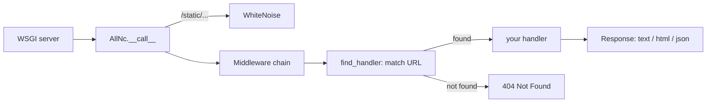

<div align="center">

# AllNc

**A tiny Python web framework you can read in one sitting.**

Routing, class-based views, templates, static files, middleware and a test client in about 170 lines of code.
Built to show how frameworks like Flask and Django work on the inside.

[](https://pypi.org/project/allnc/)


</div>

## Why AllNc?

Most web frameworks are too big to read. AllNc does the same core work in a codebase small enough to open in one tab:

| File | Lines | What it shows |
|---|---|---|
| [`allnc/app.py`](allnc/app.py) | ~110 | WSGI entry point, routing with URL parameters, method checks, templates, static files |
| [`allnc/middleware.py`](allnc/middleware.py) | ~30 | How middleware wraps an app (the "onion" model) |
| [`allnc/response.py`](allnc/response.py) | ~30 | Turning `.text`, `.html` and `.json` into a real HTTP response |

Read it, change it, break it, and you will understand what `@app.route` does in any framework.

## Quick start

```shell
pip install allnc gunicorn
```

```python
# app.py
from allnc.app import AllNc

app = AllNc()


@app.route("/")
def home(request, response):
    response.text = "Hello from AllNc!"


@app.route("/hello/{name}")
def greeting(request, response, name):
    response.json = {"message": f"Hello, {name}"}
```

```shell
gunicorn app:app
```

Open http://127.0.0.1:8000/hello/World.

## Features

- WSGI compatible: runs on Gunicorn, uWSGI or any WSGI server
- Routing with URL parameters (`/hello/{name}`)
- Function-based and class-based handlers
- Allowed HTTP methods per route (`405 Method Not Allowed` otherwise)
- Jinja2 templates
- Static files (served by WhiteNoise)
- Text, HTML and JSON response helpers
- Custom exception handler
- Middleware
- Built-in test client (no running server needed)

## How a request flows



## Guide

### Routing

```python
@app.route("/books/{book_id:d}")  # :d converts the parameter to int
def book(request, response, book_id):
    response.json = {"id": book_id}


def about(request, response):
    response.text = "About page"


app.add_route("/about", about)  # same as the decorator
```

Two routes with the same path raise an `AssertionError`, so mistakes show up at startup.

### Allowed methods

Function handlers accept every method unless you limit them:

```python
@app.route("/login", allowed_methods=["post"])
def login(request, response):
    response.text = "Logged in"
```

Class-based handlers allow only the methods they define. `allowed_methods` is ignored for them:

```python
@app.route("/books")
class Books:
    def get(self, request, response):
        response.text = "List of books"

    def post(self, request, response):
        response.text = "Book created"
```

`DELETE /books` returns `405 Method Not Allowed`.

### Responses

```python
response.text = "plain text"               # text/plain
response.html = "<h1>Hello</h1>"           # text/html
response.json = {"ok": True}               # application/json
response.status_code = 201
```

### Templates

Templates live in `templates/` by default:

```python
app = AllNc(templates_dir="templates")


@app.route("/page")
def page(request, response):
    response.html = app.template("home.html", context={"title": "AllNc", "body": "Hello!"})
```

### Static files

Files in `static/` are served under `/static/`:

```python
app = AllNc(static_dir="static")
```

```html
<link href="/static/main.css" rel="stylesheet">
```

### Custom exception handler

```python
def on_exception(request, response, exception):
    response.status_code = 500
    response.text = f"Something went wrong: {exception}"


app.add_exception_handler(on_exception)
```

Without a handler, the exception is raised as usual.

### Middleware

Subclass `Middleware` and override the hooks that run before and after each request:

```python
from allnc.middleware import Middleware


class TimingMiddleware(Middleware):
    def process_request(self, request):
        print("->", request.method, request.path)

    def process_response(self, request, response):
        print("<-", response.status_code)


app.add_middleware(TimingMiddleware)
```

## Testing

`app.test_session()` returns a [requests](https://requests.readthedocs.io/) session wired straight to your app, so tests need no running server:

```python
# conftest.py
import pytest
from allnc.app import AllNc


@pytest.fixture
def app():
    return AllNc()


@pytest.fixture
def test_client(app):
    return app.test_session()
```

```python
# test_app.py
def test_greeting(app, test_client):
    @app.route("/hello/{name}")
    def greeting(request, response, name):
        response.text = f"Hello {name}"

    assert test_client.get("http://testserver/hello/John").text == "Hello John"
```

Run the framework's own tests:

```shell
git clone https://github.com/themusharraf/allnc && cd allnc
pip install -r requirements.txt
pytest
```

## Roadmap

Good first contributions, each small enough to learn from:

- [ ] Query parameters helper (`request.args`)
- [ ] Redirect response helper
- [ ] Route groups / blueprints
- [ ] Async (ASGI) version
- [ ] Simple ORM on top of SQLite

Pick one, open an issue, and send a PR.

## O'zbekcha

AllNc — Flask va Django ichida nima bo'layotganini tushunish uchun yozilgan kichik Python web framework.
Butun kod ~170 qator: bir o'tirishda o'qib chiqib, routing, middleware va WSGI qanday ishlashini o'rganasiz.
Savollar va takliflar uchun issue oching. Foydali bo'lsa, ⭐ bosib qo'llab-quvvatlang.

## License

MIT
